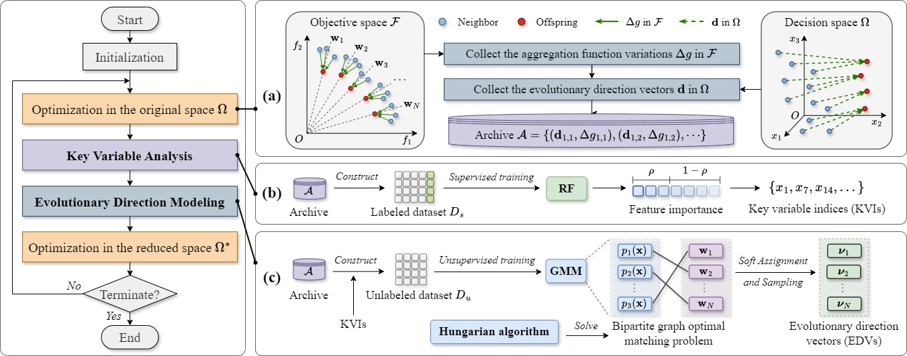

# LEAD: Learning from Evolutionary directions for convergence Acceleration and Dimensionality reduction



Paper: [Dynamic dimensionality reduction and efficient convergence acceleration for evolutionary large-scale multiobjective optimization (ESWA 2026)](https://doi.org/10.1016/j.eswa.2026.134982)

If you use this project, please cite our work:

```latex
@article{zhang2027DynamicDimensionalitya,
  title = {Dynamic Dimensionality Reduction and Efficient Convergence Acceleration for Evolutionary Large-Scale Multiobjective Optimization},
  author = {Zhang, Jingchuan and Liu, Yaxue and Wang, Xianpeng},
  year = 2027,
  month = feb,
  journal = {Expert Systems with Applications},
  volume = {334},
  pages = {134982},
  issn = {09574174},
  doi = {10.1016/j.eswa.2026.134982}
}
```
